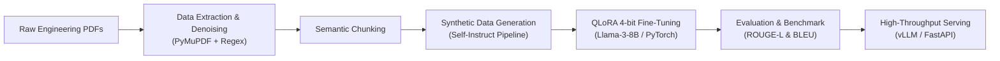

# Doc2Learn-LLM: Technical Document-to-Curriculum & Assessment Pipeline

An end-to-end Generative AI and MLOps system that transforms unstructured engineering documents (PDFs, specifications, standards) into structured learning curricula, lecture summaries, and comprehensive technical assessments using QLoRA fine-tuned Large Language Models.

---

## 🏗️ Architecture Overview



---

## 📦 Project Structure

```
Doc2Learn/
├── data/
│   ├── raw/             # Original unstructured technical documents (PDFs)
│   ├── processed/       # Extracted and denoised text chunks
│   └── synthetic/       # Instruction-response datasets (SFT format)
├── src/
│   ├── ingestion/       # PDF parsing & text extraction modules
│   ├── processing/      # Cleaning, regex filtering, and semantic chunking
│   ├── synthesis/       # Synthetic Q&A and curriculum generation pipeline
│   ├── training/        # QLoRA fine-tuning scripts (PyTorch + TRL)
│   ├── evaluation/      # Model benchmark scripts (ROUGE, BLEU, metrics)
│   └── serving/         # FastAPI & inference engine (vLLM)
├── configs/             # Training & LoRA hyperparameters (YAML)
├── tests/               # Unit and integration tests
├── requirements.txt     # Python dependencies
├── .gitignore           # Git ignore rules
└── README.md            # Project documentation
```

---

## 🚀 Key Milestones (Branches)

- `feature/phase1-data-pipeline`: PDF extraction, text normalization, and semantic chunking.
- `feature/phase2-dataset-synthesis`: Synthetic instruction-tuning dataset generator.
- `feature/phase3-qlora-finetune`: PyTorch & PEFT QLoRA 4-bit fine-tuning.
- `feature/phase4-evaluation`: Quantitative benchmarking (ROUGE-L, BLEU-4).
- `feature/phase5-serving-api`: vLLM high-speed inference & FastAPI REST endpoints.
- `feature/phase6-ui-demo`: Streamlit interactive web interface.
